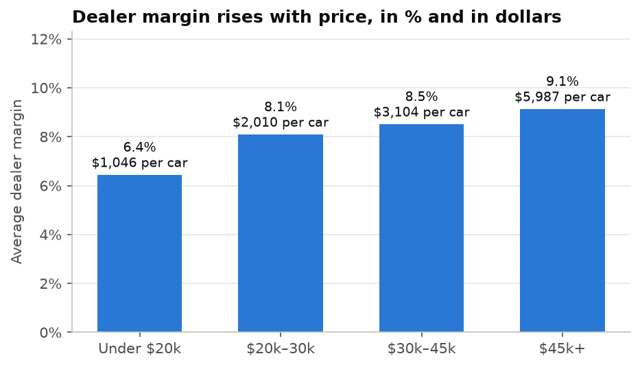
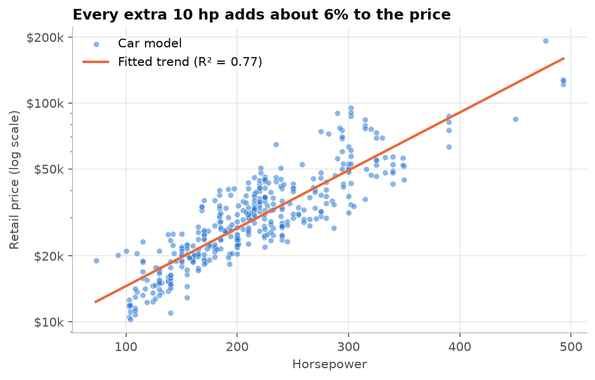
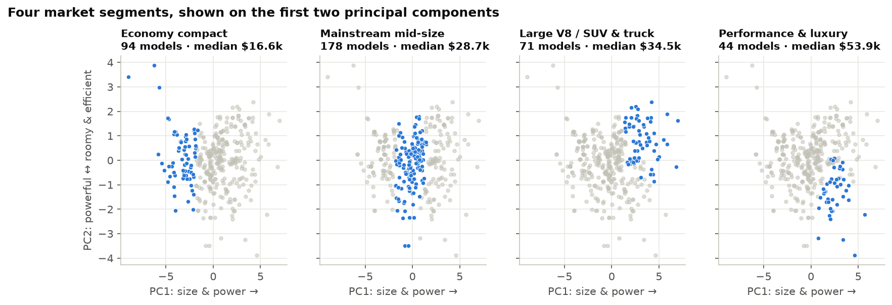
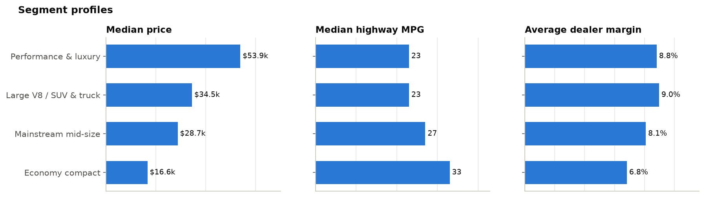
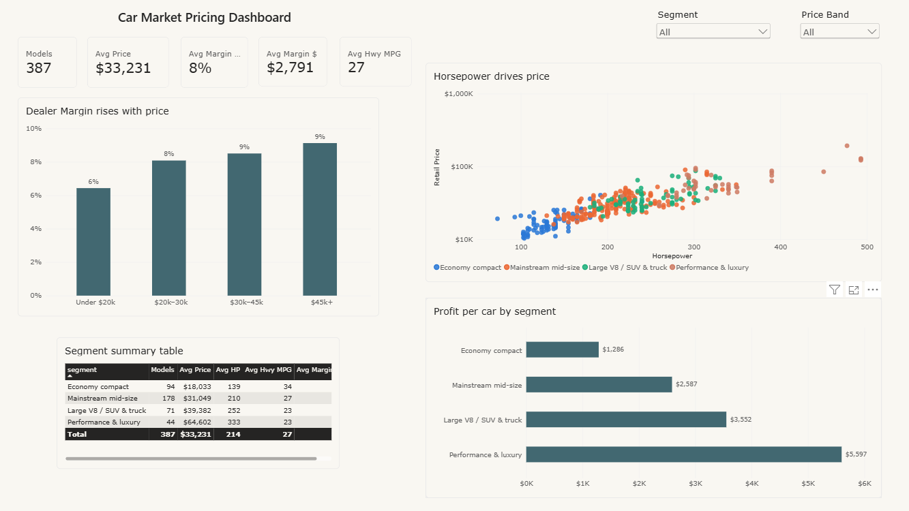

# Car Market Pricing Analysis

**What drives a car's price, where do dealers make the most margin, and which market segments are most attractive?**

An end-to-end data analysis of 387 car models using **SQL, Python and machine learning**. It goes from data quality checks to business recommendations for a dealership group.



---

## Key findings

| # | Finding | Evidence |
|---|---|---|
| 1 | **Horsepower is the main price driver.** Each extra 10 hp is associated with a **~6% higher price**. | Horsepower alone explains **77%** of the variation in log price (regression, R² = 0.77) |
| 2 | **Margin rises with price.** It goes from **6.4%** under $20k to **9.1%** above $45k. | One premium sale (~$6,000 margin) earns as much as ~**6 budget sales** (~$1,000 each) |
| 3 | **The market has four clear segments.** | Economy compact · Mainstream mid-size · Large V8 / SUV & truck · Performance & luxury |
| 4 | **Large V8 / SUV & truck models are the margin sweet spot.** | ~**9.0% margin**, about the same as performance & luxury cars, at a median price that is **~36% lower** ($34.5k vs $53.9k) |

## Recommendations

1. **Prioritise stock and marketing for the Large V8 / SUV & truck segment.** It has premium-level margin percentages at mid-market prices, with a broader pool of buyers.
2. **Treat economy compacts as a volume and customer-acquisition play,** not a profit centre. Pair them with finance, servicing and trade-in offers.
3. **Lead pricing conversations with performance,** because horsepower is what the market rewards most strongly.

---

## Analysis highlights

### What drives price?
Horsepower has the strongest correlation with price (0.84). Engine size, cylinders and weight are also strongly linked to price, but they overlap heavily with each other. To keep coefficients stable and explainable, I modelled **log(price)** starting from horsepower alone. Adding weight, fuel economy and size only lifts R² from 0.77 to 0.80.



### Market segmentation (PCA + k-means)
I used specifications only (no price), so the segments describe what the cars *are*. PCA shows that **3 components capture 90%** of the information in 9 specs. PC1 is overall "size and power"; PC2 separates roomy, economical cars from powerful ones. K-means with **k = 4** balances the silhouette score (0.31) with segments a sales team can name and act on.





### Power BI dashboard
An interactive dashboard with KPI cards, segment and price-band slicers, and cross-filtering between charts. Built in Power BI Desktop with DAX measures.



File: [`powerbi/car_market_dashboard.pbix`](powerbi/car_market_dashboard.pbix)

### SQL
All business queries live in [`sql/analysis_queries.sql`](sql/analysis_queries.sql) and run against a SQLite database. They include:
- Margin by price band and by cylinder count (`CASE`, `GROUP BY`)
- Data quality flags for unusual rows
- Best-value cars: most horsepower per $1,000 among cars with 25+ highway MPG
- Price ranking within each cylinder group using **window functions** (`RANK() OVER`, `AVG() OVER`)

---

## Data quality

- No missing values or duplicates, and dealer cost is always below retail price.
- **Genuine extremes were kept, not deleted:** hybrids (50–66 highway MPG, one with higher city than highway MPG), a 6.0L heavy SUV/truck at 10/12 MPG, and a $192k supercar. They are real vehicles, so I handled them with a log scale rather than removing them.

## Limitations

- One model year, with no make, model, trim or **sales volume** data. With sales volumes we could test whether high-margin segments also sell well.
- Margins are list-price margins. Real discounts and manufacturer incentives would change them.
- The regression shows **association, not causation.** Horsepower partly stands in for brand and luxury level, which the data doesn't include.

---

## Project structure

```
car-market-pricing-analysis/
├── data/
│   ├── raw/cars_full.csv            # original data
│   └── processed/
│       ├── cars.db                  # SQLite database
│       ├── cars_powerbi.csv         # cleaned data + segments for Power BI
│       └── segment_summary.csv      # one row per segment
├── notebooks/
│   └── car_market_analysis.ipynb    # full analysis
├── sql/
│   └── analysis_queries.sql         # all SQL queries
├── powerbi/
│   └── dashboard_guide.md           # how to build the Power BI dashboard
├── images/                          # charts used in this README
└── requirements.txt
```

## How to run

```bash
git clone https://github.com/abir110/car-market-pricing-analysis.git
cd car-market-pricing-analysis
pip install -r requirements.txt
jupyter lab notebooks/car_market_analysis.ipynb
```

With Anaconda installed, everything except `statsmodels` is already included. Run `pip install statsmodels` in Anaconda Prompt if needed.

## Tools & skills

**SQL** (SQLite, aggregations, CASE, window functions) · **Python** (pandas, NumPy) · **Statistics** (OLS regression with statsmodels) · **Machine learning** (PCA, k-means, silhouette analysis with scikit-learn) · **Data visualisation** (matplotlib) · **Power BI** · **Business communication**

## About the data

387 car models from the 2004 US market: retail price, dealer cost, engine size, cylinders, horsepower, city/highway MPG, weight and dimensions. The dataset was originally provided for a dimensionality-reduction task in my MSc Data Science *Statistical Machine Learning* module. I extended it into a full business analysis with SQL, regression, segmentation and recommendations.

---

**Author:** Abir Alam Srabon · [LinkedIn](https://www.linkedin.com/in/abir-alam-srabon) · [Email](mailto:abiralamsrabon98@gmail.com)
